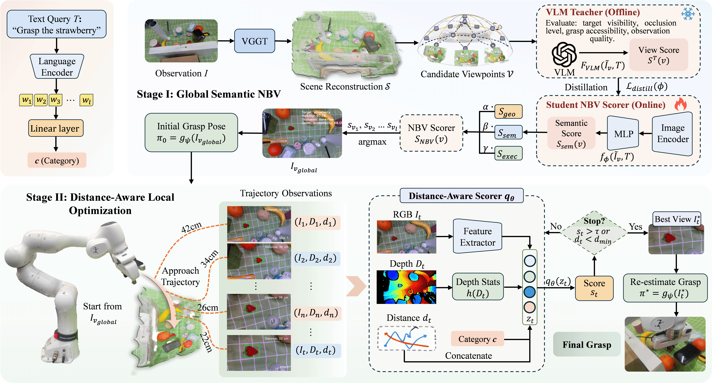

# DiNBV-Grasp

Official simulation implementation of **DiNBV-Grasp: Real-Time, Distance-Aware Two-Stage Next-Best-View Planning for Robotic Grasping**.

DiNBV-Grasp is a real-time, distance-aware next-best-view (NBV) framework for robotic grasping in cluttered and occluded scenes. It decouples global semantic exploration from local observation refinement:

- **Stage I — Global Semantic NBV:** reconstructs the scene, distills VLM knowledge into a lightweight view scorer, and selects a global viewpoint for initial grasp estimation.
- **Stage II — Distance-Aware Local Optimization:** scores RGB-D observations collected along the approach trajectory and selects an informative viewing distance for final grasp prediction.



## Architecture

```
Feature vector (1035D)
├── Visual branch  (512D) — DINOv3-Base (ViT-B/16) class token (768D)
│                            with a fixed linear projection (512D)
├── Depth branch   (10D)  — statistics from the depth map (mean, std, min, max,
│                            gradients, Sobel edges, valid-ratio, above-mean ratio)
├── Distance       (1D)   — normalized candidate distance (distance / 6.0)
└── Category       (512D) — CLIP ViT-B/32 text embedding of the object category
                             (open-world: works on unseen categories at test time)
```

A lightweight MLP with multi-head self-attention is trained to score each (image, depth, distance, category) tuple and predict whether that distance leads to a successful manipulation.

## Setup

```bash
conda create --name dinbv_grasp python=3.8
conda activate dinbv_grasp
cd DiNBV_Grasp_sim
pip install -r requirements.txt
```

Start each workflow below in `DiNBV_Grasp_sim/`. Run the three distance-selector steps in order in the same shell.

## Data Collection

Download [PartNet-Mobility](https://sapien.ucsd.edu/downloads) URDF files and place them under `data_collection/asset/`:

```
data_collection/asset/
├── 148/
│   └── mobility.urdf
├── 149/
│   └── mobility.urdf
└── ...
```

Then use the unified `gen_data.sh` script to generate data. All data-collection tasks are covered by a single script with `--mode` and `--distance` arguments:

```bash
cd data_collection/code

# Backbone training data (~20,000 samples, random camera placement)
bash scripts/gen_data.sh --mode train --distance random --processes 24 --epochs 50 --start 1

# Distance-selector test data — multi-distance sweep 1.0m–6.0m every 0.1m (~1,500 samples)
bash scripts/gen_data.sh --mode test --distance multi --processes 10 --epochs 10 --start 1

# Fixed-distance data at a specific distance (optional, for ablations)
bash scripts/gen_data.sh --mode train --distance 3.0 --processes 16 --epochs 50
```

## Model Training (ManipLLM backbone)

Download the required checkpoints and place them under `train/ckpts/`:

```
train/ckpts/
├── llama_model_weights/
│   ├── 7B/
│   │   ├── checklist.chk
│   │   ├── consolidated.00.pth
│   │   └── params.json
│   └── tokenizer.model
├── BIAS_LORA_NORM-336-Chinese-7B.pth
└── ViT-L-14-336px.pt
```

- **CLIP checkpoint**: [download](https://disk.pku.edu.cn/link/AA93FF7210CF0D4F428850C0F520C81453)
- **LLaMA-Adapter checkpoint**: [download](https://disk.pku.edu.cn/link/AA682A19DB7FDA4028B112449D24BBC308)
- **LLaMA-7B weights**: apply via the official [request form](https://docs.google.com/forms/d/e/1FAIpQLSfqNECQnMkycAp2jP4Z9TFX0cGR4uf7b_fBxjY_OjhJILlKGA/viewform)

Training requires at least 40 GB GPU memory. A single `finetune.sh` handles all distance configurations:

```bash
cd train

# Train on random-distance data (original ManipLLM baseline)
bash finetune.sh

# Train on fixed-distance data (e.g. 3.0m), optionally specify GPU
bash finetune.sh 3.0
bash finetune.sh 4.0 1   # use GPU 1
```

## Distance Selector Training

### Step 1 — Extract features

```bash
cd hybrid_distance_selector
conda activate dinbv_grasp

python extract_features_with_clip.py \
    --eval_dir ../test/test_results/distance_eval_results_test_v1 \
    --data_dir ../data_collection/data/test_data_camera_distances_v1 \
    --device cuda \
    --feature_prefix features_dinov3_base_clip_
```

Each sample produces a 1035D feature vector per candidate distance, saved alongside the evaluation results. Use features extracted with DINOv3-Base to train the matching discriminator checkpoint.

### Step 2 — Train the discriminator

```bash
CUDA_VISIBLE_DEVICES=0 python train_distance_discriminator.py \
    --eval_dir ../test/test_results/distance_eval_results_test_v1 \
    --output_dir ../models/discriminator_ckpts \
    --feature_prefix features_dinov3_base_clip_ \
    --input_dim 1035 \
    --use_data_split \
    --epochs 50 \
    --batch_size 32 \
    --lr 1e-3 \
    --device cuda
```

### Step 3 — Evaluate

```bash
# (Optional) Pre-build a history cache for faster repeated evaluation
python build_history_cache.py \
    --eval_dir ../test/test_results/distance_eval_results_test_v1 \
    --output results/history_cache.pkl

# Benchmark distance selection with the saved features
CUDA_VISIBLE_DEVICES=0 python benchmark_distance_selector.py \
    --eval_dir ../test/test_results/distance_eval_results_test_v1 \
    --data_dir ../data_collection/data/test_data_camera_distances_v1 \
    --discriminator ../models/discriminator_ckpts/discriminator_best.pth \
    --history_cache results/history_cache.pkl \
    --output results/benchmark_results.json \
    --feature_prefix features_dinov3_base_clip_ \
    --use_attention \
    --device cuda \
    --test_only
```

## Model Testing (full pipeline)

Place test checkpoints under `test/ckpts/` (same structure as `train/ckpts/`). Download the released manipulation checkpoint [checkpoint-9-ori](https://pan.baidu.com/s/1kh_LO7W7TnnrpPzI4khw0Q?pwd=cipc) or use your own. Download test data from [here](https://disk.pku.edu.cn/link/AA103C5B00398E4E4089903CB06AC09D8C) and unzip under `data_collection/data/`.

```bash
cd test
bash test.sh
```

## Repository Structure

- [`assets/framework.png`](assets/framework.png) contains the paper's framework diagram.
- [`DiNBV_Grasp_sim/data_collection/`](DiNBV_Grasp_sim/data_collection/) generates SAPIEN simulation data.
- [`DiNBV_Grasp_sim/train/`](DiNBV_Grasp_sim/train/) trains the ManipLLM backbone.
- [`DiNBV_Grasp_sim/test/`](DiNBV_Grasp_sim/test/) runs the simulation evaluation.
- [`DiNBV_Grasp_sim/hybrid_distance_selector/`](DiNBV_Grasp_sim/hybrid_distance_selector/) extracts DINOv3-Base features and trains and evaluates the distance selector.

## Acknowledgements

This project builds on [ManipLLM](https://github.com/clorislili/ManipLLM) (CVPR 2024), which in turn benefits from [LLaMA-Adapter](https://github.com/OpenGVLab/LLaMA-Adapter) and [Where2Act](https://github.com/daerduoCarey/where2act). The distance selector uses [DINOv3-Base (ViT-B/16)](https://huggingface.co/timm/vit_base_patch16_dinov3.lvd1689m) via [timm](https://github.com/huggingface/pytorch-image-models) and [OpenCLIP](https://github.com/mlfoundations/open_clip) for open-world category encoding.

## TODO

- [ ] Release an improved version of DiNBV-Grasp (v2).

## License

This project is released under the [MIT License](LICENSE).
